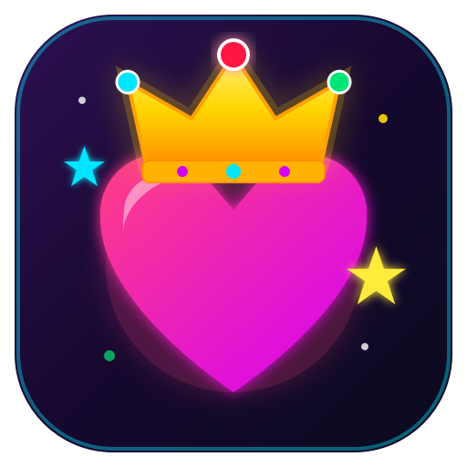
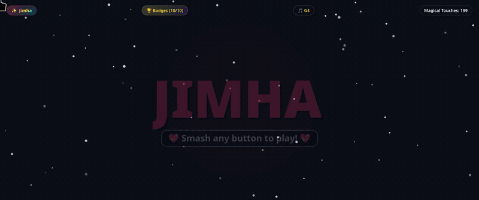
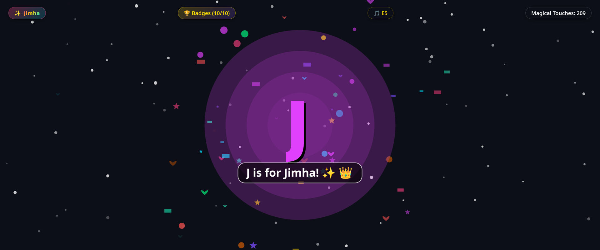
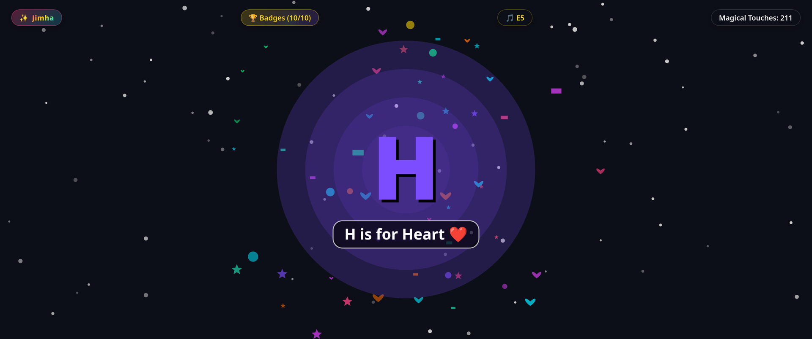
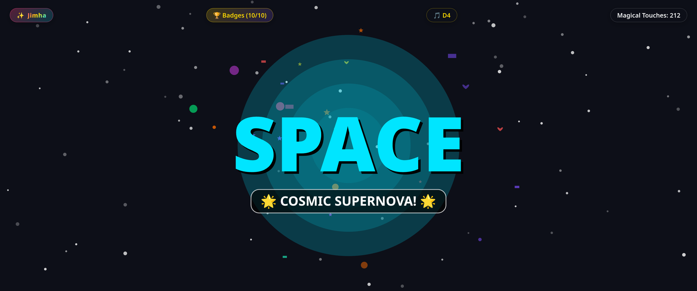
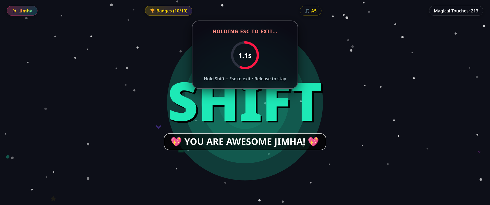

<div align="center">



# Jimha 👑💖✨

**Next-Gen Adaptive Sensory Playground for Toddlers**

[](LICENSE)
[](https://tauri.app)
[](https://svelte.dev)
[](https://pixijs.com)
[](https://github.com/kuasha420/jimha)
[](https://github.com/kuasha420/knot-mesh)

</div>

---

## 🎮 Steam-Style Product Showcase

<table>
<tr>
<td width="65%" valign="top">

<!-- Steam Hero Animated Trailer / Banner -->


<p align="center">
  🎬 <b>Live Gameplay Trailer:</b> <i>Bouncing letters, particle fireworks, pentatonic chimes & 3s hold-to-exit HUD</i>
  <br>
  <a href="assets/demo_trailer.mp4"><b>▶ Download / Watch Full HD Video Trailer (assets/demo_trailer.mp4)</b></a>
</p>

</td>
<td width="35%" valign="top">

### 🕹️ Game Overview
*Smash any button, paint the universe!* A gentle, toddler-proof sensory playground crafted with love for Jimha.

- **Reviews**: ⭐⭐⭐⭐⭐ *Overwhelmingly Positive* (100% Toddler & Baby Approved 💖)
- **Engine**: Tauri v2 + Pixi.js v8 + Svelte 5 + Rust
- **Developer**: Arafat Zahan *(with Jimha & AI Agent)*
- **Publisher**: Purrfect Universe
- **Audio Engine**: Web Audio API Synthesizer (Zero GC)
- **Display Target**: Wayland / X11 / SteamOS Fullscreen 60–120 FPS
- **Tags**: `Casual` • `Kids` • `Tactile` • `Sensory` • `Toddler-Safe` • `Music-Box`

</td>
</tr>
</table>

### 📸 Gameplay Screenshots

<table>
<tr>
<td width="50%">
  
  <p align="center"><b>👑 J is for Jimha!</b><br><i>Spring bounce with royal crown & electric confetti</i></p>
</td>
<td width="50%">
  
  <p align="center"><b>💖 Jim Heart Easter Egg</b><br><i>The legendary Easter egg honoring the session's first spark</i></p>
</td>
</tr>
<tr>
<td width="50%">
  
  <p align="center"><b>🌟 Cosmic Supernova</b><br><i>Pressing Space explodes rainbow starburst particles</i></p>
</td>
<td width="50%">
  
  <p align="center"><b>🛡️ Toddler-Safe Exit HUD</b><br><i>Hold ESC for 3.0s continuously to close; quick taps never exit</i></p>
</td>
</tr>
</table>

---

## 📖 The Origin Story

**Jimha** was born during Jimha's very first **agentic pair programming session**. 

Sitting with a Steam Deck handheld running Arch Linux, her father gave a simple, loving challenge to an autonomous AI agent: create a magical visual playground for Jimha that reacts to any random keyboard smash with giant bouncing characters, colorful companion emojis, and soothing sounds — without letting curious little hands accidentally close the game.

Because the command originated from a handheld device, the prototype was orchestrated across the [**Knot Mesh**](https://github.com/kuasha420/knot-mesh) — projecting and running live in fullscreen on the Desktop PC monitor across the room in real time.

Today, **Jimha** has evolved into a next-generation sensory game engine powered by **Tauri v2**, **Pixi.js v8**, **Svelte 5**, and a **Rust** backend, while the original Python prototype is safely preserved in [`legacy/python_prototype/`](legacy/python_prototype/).

---

## ✨ Features

- **🎮 Giant Responsive Key Animations**: Every key press triggers massive typography scaling with elastic spring physics, radiant glowing halos, and vibrant pastel-neon palettes.
- **🦄 Alphabet & Companion Emojis**:
  - **`J`**: 👑 **Jimha!** ✨
  - **`H`**: 💖 **Jim Heart (Easter Egg!)** 💖
  - **`A`–`Z`**: 🍎 Apple, 🦋 Butterfly, 🐱 Cat, 🐶 Dog, 🐘 Elephant, 🌸 Flower, 🎸 Guitar...
  - **`0`–`9`**: Huge digits accompanied by that exact number of glittering stars.
  - **`Space`**: 🌟 Cosmic supernova fireworks!
  - **`Enter`**: 🎉 Party celebration balloons and confetti!
  - **`Backspace`**: 🫧 Bubble pop flurry!
  - **`Arrow Keys`**: 🚀 Directional zoom and dive effects!
- **🫧 Multi-Touch & Pointer Interaction**: Multi-finger drumming and palm taps spawn floating, translucent bubbles that rise and pop.
- **🎵 Soothing Pentatonic Chimes**: Real-time celestial celesta and bell synthesis across an 11-tone pentatonic scale (C4–C6). Rapid smashing sounds like a melodious wind chime, never dissonant.
- **🛡️ Toddler-Safe Exit Protection (3-Second ESC Hold)**: Accidental hits on `Escape` will **not** close the game. To exit, a parent must hold `Escape` continuously for 3.0 seconds. A circular HUD countdown overlay displays progress and immediately cancels if released early.
- **⚡ Native Hardware Acceleration**: 60–120 FPS high-refresh rate canvas rendering powered by Pixi.js v8 and WebGL/WebGPU.

---

## 🚀 Development & Verification

### Prerequisites
- Node.js >= 20, pnpm >= 9
- Rust >= 1.78 and Cargo

### Install Dependencies
```bash
pnpm install
```

### Run Frontend in Development
```bash
pnpm dev
```

### Run Desktop Application (Tauri v2)
```bash
pnpm tauri dev
```

### Hermetic Verification Suite
Run the unified frontend and native backend verification suites:

```bash
# Frontend Vitest suite (sub-second SLA)
pnpm test

# Rust native backend test suite
cargo test --manifest-path src-tauri/Cargo.toml
```

---

## 📦 Legacy Prototype
The original Python/PyQt6 prototype and its build artifacts are archived under [`legacy/python_prototype/`](legacy/python_prototype/).

---

## 📄 License

Released under the [MIT License](LICENSE). Dedicated with love to Jimha. 💖
