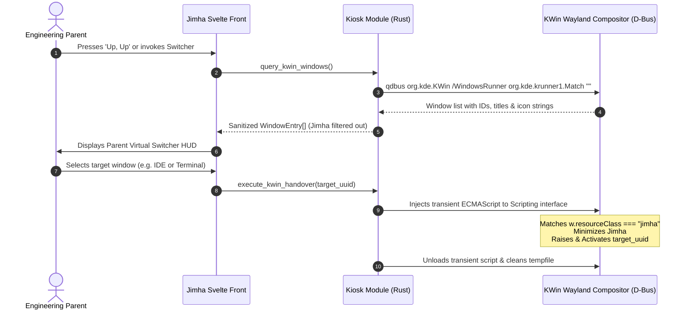

# Jimha Architecture & Systems Engineering Deep-Dive

<!-- SPDX-License-Identifier: MIT -->
<!-- Copyright (c) 2026 Arafat Zahan (@kuasha420) -->

## 1. Architectural Philosophy & The Sovereign Product Guarantee

Jimha is engineered as a **100% sovereign, self-contained, offline-first sensory playground**.

While its historical engineering spark originated during an exploratory pair-programming session orchestrated across the Knot Mesh (a multi-node hardware cluster), **Jimha as a software product possesses zero hard dependencies on external daemons, cloud endpoints, or external network fabrics**. 

```
┌────────────────────────────────────────────────────────────────────────┐
│                   SOVEREIGN PRODUCT GUARANTEE                          │
│                                                                        │
│   • 0 External Cloud Endpoints   • 0 Network Sockets Required          │
│   • 0 Telemetry / Phoning Home   • 100% Air-Gapped Toddler Safety      │
│   • Standard XDG File Layout     • Deterministic Cold-Boot Under 300ms │
└────────────────────────────────────────────────────────────────────────┘
```

A parent on a commercial airliner or off-grid cabin running Arch Linux, Fedora, Ubuntu, SteamOS, or an Android tablet can launch Jimha in complete airplane mode:
1. **Zero External Sockets**: The application binds zero listening TCP/UDP ports and initiates zero outbound HTTP/WebSocket network connections.
2. **Local-First XDG Persistence**:
   - Runtime configuration and unlocks: `$XDG_DATA_HOME/jimha/` (defaulting to `~/.local/share/jimha/`).
   - Pre-synthesized audio PCM and temporary scratch buffers: `$XDG_CACHE_HOME/jimha/` (defaulting to `~/.cache/jimha/audio_cache_v2/`).
3. **Hermetic Packaging**: Self-contained Flatpak bundles and native packages embed all vector artwork, fonts, and DSP synthesis routines directly into the distribution archive.

---

## 2. High-Level System Architecture

Jimha is constructed using **Tauri v2** as the native host bridge, **Pixi.js v8** as the 120 FPS WebGPU/WebGL rendering pipeline, and **Svelte 5** (utilizing fine-grained `$state` and `$derived` Runes) for deterministic UI overlays and modal state machines.

```mermaid
flowchart TD
    subgraph Host["Operating System & Kernel"]
        PW["PipeWire / PulseAudio Daemon"]
        KWIN["KWin Wayland Compositor (D-Bus)"]
        FS["XDG File System (~/.local/share/jimha)"]
    end

    subgraph RustCore["Rust Native Backend (src-tauri)"]
        TAURI["Tauri v2 Runtime"]
        AUDIO_ENGINE["NativeAudioEngine<br/>(pw-play / paplay voice pool)"]
        KIOSK_ENGINE["Kiosk Controller<br/>(qdbus / ECMAScript injector)"]
        WAV_GEN["Synthesizer / WAV Header Generator"]
    end

    subgraph WebEngine["Frontend Engine (Pixi.js v8 + Svelte 5)"]
        INPUT["InputMultiplexer & Gamepad Subsystem"]
        CANVAS["PixiCanvas (120 FPS WebGL/WebGPU)"]
        PARTICLES["Particle Burst & Spring Physics"]
        BUBBLE_LAGOON["Bubble Lagoon (25 Ceiling FIFO)"]
        BGM_FSM["Ambient Generative BGM FSM"]
        WEB_AUDIO["Web Audio API Fallback Synthesizer"]
        OVERLAYS["Svelte 5 Runes Overlays<br/>(ExitHoldHud, StickerBook, VirtualSwitcher)"]
    end

    INPUT --> CANVAS
    INPUT --> BGM_FSM
    CANVAS --> PARTICLES
    CANVAS --> BUBBLE_LAGOON
    INPUT -. IPC .-> TAURI
    TAURI --> AUDIO_ENGINE
    TAURI --> KIOSK_ENGINE
    AUDIO_ENGINE --> PW
    AUDIO_ENGINE --> WAV_GEN
    WAV_GEN --> FS
    KIOSK_ENGINE -. org.kde.KWin .-> KWIN
    BGM_FSM --> WEB_AUDIO
    INPUT --> OVERLAYS
```

---

## 3. Double-Barreled Audio Engine

Toddlers smash keyboards with open palms and unpredictable fury. Standard browser audio engines quickly suffer from garbage-collection stutter, audio context clipping, or crackling when subjected to 15 concurrent keystrokes. 

Jimha resolves this with a **Double-Barreled Audio Architecture**:

```
                       ┌─────────────────────────┐
                       │ Keystroke / Touch Event │
                       └────────────┬────────────┘
                                    │
                    ┌───────────────┴───────────────┐
                    ▼                               ▼
       [Linux Desktop / SteamOS]         [Fallback / Web Platform]
       Native Audio Engine (Rust)         Web Audio API Synthesizer
       ─────────────────────────         ─────────────────────────
       • PipeWire (`pw-play`)            • Zero-GC Web Audio Context
       • `--media-role=Game`             • Polyphonic Synthesizer
       • Pre-warmed 44.1kHz WAVs         • Master Gain Clamped at 0.8
       • Hard Voice Stealing (max 4)     • Dynamic Ducking Architecture
```

### A. Native PipeWire Engine (`src-tauri/src/audio.rs`)
Under Linux and SteamOS, audio events are offloaded over Tauri IPC to `NativeAudioEngine`:
- **Direct PipeWire Handover**: Dispatches playback directly via `pw-play --media-role=Game --volume=0.8` (or `paplay` on legacy PulseAudio systems).
- **Pre-warmed Harmonic Cache**: Generates 44.1 kHz 16-bit stereo PCM WAV files with RIFF headers into `$XDG_CACHE_HOME/jimha/audio_cache_v2/` on cold boot. The waveform combines five harmonic overtones ($1.0f$, $2.0f$, $3.0f$, $4.2f$, $5.4f$) with dual exponential decay envelopes ($e^{-2.5t}$ body, $e^{-5.5t}$ shimmer).
- **Strict 4-Voice Stealing**: Key drumming can spawn dozens of notes per second. `NativeAudioEngine` maintains an internal process pool bounded to 4 concurrent voices. When voice 5 arrives, the oldest process is cleanly terminated (`pool.drain(..1).next().kill()`), eliminating acoustic distortion and CPU thread exhaustion.

### B. Web Audio Synthesizer Fallback (`src/lib/audio/`)
When running outside native PipeWire environments:
- Employs Web Audio API with zero-allocation buffer caches.
- Clamps master output gain to `0.8` to satisfy **Invariant 2 (Pediatric Hearing Protection)**.
- Uses micro-fade envelopes on note releases to prevent speaker pop transients.

### C. Generative Ambient BGM State Machine (`src/lib/audio/ambient-bgm.ts`)
Jimha features a continuous generative soundtrack tuned to celestial music box harmonics. The background music operates as a 3-state finite state machine (FSM):

| State | Volume | Musical Behavior | Trigger Condition |
| :--- | :--- | :--- | :--- |
| **`idle`** | `0.15` | Soothing starlit arpeggio (C4–C6) cycling every 4.2 seconds | Normal exploration or attract mode |
| **`playing`** | `0.05` | Ducks down by 10 dB into the background | Active key smashing / drumming (restores 1.8s after last input) |
| **`ui`** | `0.10` | Warm low-pass filtered chord progression | Open Sticker Book modal or Parent HUD |

---

## 4. Kiosk Mode & KWin D-Bus Handover

When toddlers play, accidental window switches or taskbar interactions ruin the immersive sensory cocoon. In enterprise or arcade environments, typical kiosk applications brutally capture global inputs or minimize every other window on screen. 

Jimha implements surgical compositor integration:



### Key Technical Safeguards:
1. **Surgical Resource Matching**: KWin scripts generated by `synthesize_kwin_handover_script` explicitly target `w.resourceClass === "jimha"` or exact caption `Jimha`. Unlike naive pattern matchers, this never inadvertently minimizes a parent's terminal or code editor with "jimha" in the file path.
2. **KWin Shortcut Inhibition Rule**: Under KDE Plasma 6, `ensure_kwin_shortcut_inhibition()` registers a `jimha_lockdown` entry in `kwinrulesrc` with `disableglobalshortcuts=true`, preventing accidental workspace switching or system launcher activation while the game is focused.
3. **Transient Script Lifecycle**: Handover ECMAScript files are written to `/tmp/jimha_handover_<pid>.js`, executed via `org.kde.kwin.Scripting`, and immediately unloaded and removed from disk.

---

## 5. PixiJS v8 High-Refresh Rendering Pipeline

The visual engine is built on Pixi.js v8 to sustain 120 FPS animation on variable refresh rate displays (Steam Deck OLED, gaming monitors).

```
 ┌───────────────────────────────────────────────────────────────┐
 │               PIXI.JS V8 SCENE GRAPH TOPOLOGY                 │
 │                                                               │
 │  ┌─────────────────────────────────────────────────────────┐  │
 │  │ Scene Container (Root)                                  │  │
 │  │                                                         │  │
 │  │  ├── Background Ambient Starlight Starfield             │  │
 │  │  ├── Bubble Lagoon Layer (Max 25 Bubbles, FIFO pruned)  │  │
 │  │  ├── Primary Character Spring Container                 │  │
 │  │  │   ├── Giant Character Glyph (Font: Quicksand/Baloo)  │  │
 │  │  │   └── Radiant Halo / Glow Filter                     │  │
 │  │  ├── Companion Emoji Sprite                             │  │
 │  │  └── Particle Fireworks Emitters (Recycled Object Pool) │  │
 │  └─────────────────────────────────────────────────────────┘  │
 └───────────────────────────────────────────────────────────────┘
```

### A. Elastic Spring Typography (`src/lib/engine/spring.ts`)
Characters scale dynamically with a second-order spring dynamics curve:
$$\ddot{x} + 2\zeta\omega\dot{x} + \omega^2(x - x_{\text{target}}) = 0$$
- Initial scale: $0.20$ (spawns from deep center).
- Peak overshoot: $1.28$ (explosive bouncy pop).
- Settling equilibrium: $1.00$ with gentle damped oscillation.

### B. Dynamic Cadence Window Throttling (`src/lib/engine/particles.ts`)
To protect toddlers from visual overstimulation and prevent GPU vertex thrashing:
- The system measures input density over a rolling 500ms sliding window.
- **Normal Play** ($< 4$ keys / 500ms): Emits 28 high-velocity rainbow particles with gravity and velocity decay.
- **Rapid Smashing** ($\ge 4$ keys / 500ms): Throttles emitter burst down to 8 compact particles.

### C. 25-Bubble Lagoon Ceiling
Tapping or pointer drag across the display spawns interactive floating soap bubbles.
- To prevent unbounded memory consumption and visual clutter, the bubble collection is clamped to a strict maximum of **25 bubbles**.
- When bubble 26 is spawned, the oldest existing bubble immediately pops with a soft chime and radial mist particle burst before removal.

---

## 6. Svelte 5 Runes & State Management

The frontend state architecture avoids legacy stores in favor of modern **Svelte 5 Runes**:
- `$state` powers interactive modal states, cadence counters, and active badges.
- `$derived` computes reactive metrics such as remaining exit-hold duration and active theme palettes.
- `$effect` manages clean mounting and teardown of Pixi canvas viewports and resize observers.

```svelte
<!-- Example Svelte 5 Runes Architecture in ExitHoldHud.svelte -->
<script lang="ts">
  let { isHolding = false, progress = 0 } = $props();
  let ringDashOffset = $derived(283 * (1 - progress));
  let statusText = $derived(progress >= 1.0 ? "UNLOCKED!" : "HOLD TO EXIT");
</script>
```

---

## 7. Verification Standards & Benchmarks

In compliance with **PSL-INV-001** and **PSL-INV-002**:
- **Frontend Test Suite**: 11 test suites comprising 69 vitest unit tests executing in **<1.7 seconds**.
- **Rust Backend Suite**: Hermetic cargo unit tests verifying RIFF header construction, UUID string parsing, base64 encoding, and KWin script synthesis executing in **<0.5 seconds**.
- **Zero Synthetic Mocks**: Audio tests validate real generated binary WAV buffers and byte headers.
