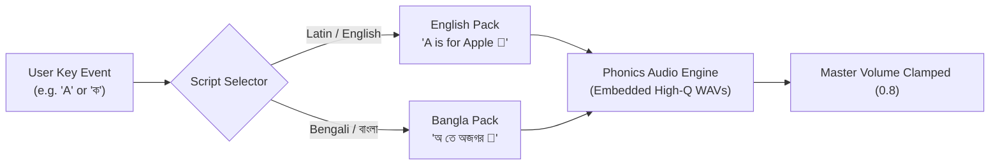

# Jimha Macro Product Roadmap: The 5 Concurrent Tracks

<!-- SPDX-License-Identifier: MIT -->
<!-- Copyright (c) 2026 Arafat Zahan (@kuasha420) -->

> _"Toddlers do not grow in rigid waterfall milestones; their cognitive leaps happen across speech, motor control, musical harmony, and visual curiosity all at once. Jimha's architecture evolves concurrently across 5 Parallel Capability Tracks."_

Traditional roadmap models force sequential phasing (Phase 1, then Phase 2). Jimha rejects this linear constraint in favor of **5 Concurrent Capability Tracks**. Each track evolves independently and continuously, allowing improvements to core sensory physics to ship alongside phonics packs or packaging enhancements.

```
┌────────────────────────────────────────────────────────────────────────┐
│                   THE 5 CONCURRENT CAPABILITY TRACKS                   │
├────────────────────────────────────────────────────────────────────────┤
│ Track A ── [Sensory Foundations & Toddler Invariants]   (Active Core)  │
│ Track B ── [Dynamic Progression & Adaptive Growth Tiers] (18mo ➔ 4yr)  │
│ Track C ── [Polyglot Multiverse & Phonics Engine]       (EN + বাংলা)   │
│ Track D ── [Multiplatform Fleet & Knot Mesh Swarm]      (Deck + Mobile)│
│ Track E ── [Evergreen SWE, Cleanroom & Packaging]       (AUR + Flatpak)│
└────────────────────────────────────────────────────────────────────────┘
```

---

## Track A: Sensory Foundations & Toddler Invariants

_Focus: 120 FPS rendering, zero-jitter input handling, acoustic safety, and toddler boundary enforcement._

### Current Status: **Active Production Baseline (v2.0)**

- [x] Full implementation of **The 7 Dad-Mode Invariants** (Exit fortress, 0.8 hearing clamp, 25-bubble lagoon ceiling, cadence throttling, 20s attract drift, gesture gate, pure pentatonic tuning).
- [x] Double-barreled audio architecture: Linux PipeWire `pw-play` with 4-voice process stealing + Web Audio stereo 16-bit PCM fallback.
- [x] Pixi.js v8 rendering pipeline with elastic spring curve ($0.20 \rightarrow 1.28 \rightarrow 1.00$) and WebGPU/WebGL acceleration.
- [x] KWin Wayland transient ECMAScript injection with exact window class filtering (`w.resourceClass === "jimha"`).

### Near-Horizon Horizons (v2.1 – v2.2)

- [ ] **Variable Refresh Rate (VRR) Pacing**: Adaptive frame timing lock for 40Hz, 90Hz, and 120Hz OLED panels (Steam Deck OLED, gaming monitors) with sub-millisecond input-to-photon latency.
- [ ] **Haptic Feedback Integration**: Dual-actuator haptic pulse patterns on Steam Deck touchpads and supported gamepads when popping bubbles or triggering supernovas.
- [ ] **Micro-Acoustic Overdrive Shield**: Dynamic limiter in Web Audio worklet to eliminate sudden peak transients on extreme 20-finger multi-touch screen slaps.

---

## Track B: Dynamic Progression & Adaptive Growth Tiers

_Focus: Evolving with the child from 18 months through preschool._

```
   EXPLORER TIER (18–24 Months)     ADVENTURER TIER (2–3 Years)      CREATOR TIER (3+ Years)
   ────────────────────────────     ───────────────────────────      ───────────────────────
   • Cause-and-Effect Smashes       • Color & Shape Identification   • Freeform Particle Painting
   • Floating Bubble Lagoon         • Star Constellation Counting    • Musical Chord Sequencing
   • Confetti & Supernovas          • Sticker Book Discovery (7/7)   • Stamp Placement & Canvas Save
```

### 1. Explorer Tier (18–24 Months) — _Active Baseline_

- Primary objective: Cause-and-effect cognitive development.
- Single-action immediate payoff: giant characters, high-contrast glow, bouncy spring recoil, and soothing pentatonic chimes.
- Involuntary input protection (elbow and forearm rejection).

### 2. Adventurer Tier (2–3 Years) — _In Development_

- Guided cognitive discovery:
  - **Color Mastery Mode**: Tapping colors cycles the entire scene theme (Ruby Red, Emerald Green, Ocean Blue) while voicing the color name.
  - **Star Constellation Counting**: Number keys display both the digit and animated stars that can be tapped to count aloud ($1 \dots 2 \dots 3$).
  - **Shape Morphology**: Geometry transformations (Circle $\rightarrow$ Triangle $\rightarrow$ Star $\rightarrow$ Hexagon).
- Achievement celebration: Dynamic unlock banners in `UnlockCelebrationBanner.svelte`.

### 3. Creator Tier (3+ Years) — _Architectural Design_

- Freeform artistic expression:
  - **Finger-Trail Ribbon Brush**: Toddler finger dragging leaves glowing neon comet ribbons that gently sparkle and dissolve.
  - **Sticker Canvas**: Ability to drag unlocked stickers from the Sticker Book directly onto the ambient playfield.
  - **Simple Melody Sequence**: Recalling simple 3-note sequences played by the celestial celesta.

### 4. Multi-Child Profiles & Parental Dashboard

- Profile segregation: `$XDG_DATA_HOME/jimha/profiles/<child_id>.json`.
- Settings customizer: Configurable exit hold durations (2.0s to 5.0s), custom volume ceilings, and instrument timbre selection (Celesta, Harp, Marimba, Music Box).

---

## Track C: Polyglot Multiverse & Phonics Engine

_Focus: Bilingual language exposure, natural native pronunciation, and non-Latin typography._

Jimha's origin story is inherently bilingual—born from a father speaking Bengali to an English-trained agent. Track C expands this heritage into a rich polyglot learning engine.



### Horizons

- [ ] **Bangla Alphabet Pack (বাংলা বর্ণমালা)**:
  - Full support for **স্বরবর্ণ** (অ, আ, ই, ঈ, উ, ঊ, ঋ, এ, ঐ, ও, ঔ) and **ব্যঞ্জনবর্ণ** (ক, খ, গ, ঘ, ঙ...).
  - Culturally resonant companion glyphs (e.g., _আম_, _ইলিশ_, _চাঁদ_, _দোয়েল_).
  - Open-source Bengali typography optimized for large-scale spring bounce rendering (e.g., _Galada_, _Hind Siliguri_).
- [ ] **Local-First Natural Toddler Speech (Zero-Cloud Phonics)**:
  - 100% offline pre-recorded high-fidelity phonics samples spoken by native speakers in warm, maternal/paternal tones.
  - Zero external neural TTS APIs or cloud transcription dependencies.
- [ ] **Polyglot Instant Switcher**:
  - Two-finger tap on the corner emblem toggles between English and Bangla packs dynamically.

---

## Track D: Multiplatform Fleet & Knot Mesh Swarm

_Focus: Hardware optimization across handhelds, tablets, and distributed displays._

```
                 ┌───────────────────────────────────────────────┐
                 │          JIMHA MULTIPLATFORM RUNTIMES         │
                 └───────────────────────┬───────────────────────┘
                                         │
        ┌────────────────────────────────┼────────────────────────────────┐
        ▼                                ▼                                ▼
   [SteamOS / Linux]             [Android Tablets]               [Knot Mesh Swarm]
   • Steam Deck Handheld         • Dedicated Touch Kiosk         • Remote Wayland Cast
   • Gyro Bubble Aiming          • Immersive Pinning             • Distributed Sound
   • Gamepad D-Pad Nav           • ARM64 Hardware NEON           • Multi-Screen Mirror
```

### 1. Steam Deck & SteamOS Handheld First-Class Citizen

- **Gamepad Subsystem (`src/lib/engine/gamepad.ts`)**:
  - D-Pad navigation for UI elements.
  - Face buttons trigger chorded harmony chimes.
  - Triggers and bumpers spawn directional bubble jets.
- **Gyroscope & Accelerometer Integration**:
  - Tilting the Steam Deck causes floating bubbles to drift with simulated physical gravity.

### 2. Android Tablet Sovereign Package

- Standalone Android APK / AAB deployment via Tauri v2 Android target.
- Fullscreen immersive mode with system gesture exclusion zones to prevent accidental navigation bar swipes.
- Offline local SQLite / JSON profile persistence in Android internal storage sandbox.

### 3. Knot Mesh Swarm Coordination (Optional Enterprise / Lab Mode)

- While Jimha is 100% self-contained by default, pairing with the Knot Mesh unlocks:
  - Remote screen casting from Steam Deck to Living Room 4K OLED over Wayland/PipeWire streaming.
  - Parent telemetry mirror: monitor play duration and unlocked badges from a secondary device.

---

## Track E: Evergreen Software Engineering & Packaging

_Focus: Cleanroom verification, hermetic builds, distribution packaging, and sub-second test SLAs._

### Architectural Invariants

- **`JIMHA-INV-EVERGREEN`**: Dependency hygiene enforcing modern Tauri v2, Pixi.js v8, and Svelte 5 without legacy deprecated APIs.
- **Sub-Second Test SLA**: Unit test suites must execute in $< 1.0$ second (frontend) and $< 0.1$ second (Rust backend).
- **Cleanroom Verification**: Strict separation between system integrations and application core logic.

### Distribution Targets

- [x] **Arch Linux AUR / Local `makepkg`**: Production-tested `PKGBUILD` compiling native binary with desktop and metainfo integration.
- [x] **Flatpak (`org.purrfect.jimha`)**: Complete Flatpak manifest in `packaging/flatpak/org.purrfect.jimha.yml` using modern GNOME runtime.
- [ ] **Steam Deck Non-Steam One-Click Installer**: Automated script adding Jimha directly to Steam Deck Gaming Mode library with official hero artwork.
- [ ] **AppImage**: Standalone cross-distribution portable binary for off-grid USB drive distribution.
